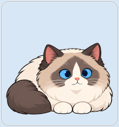
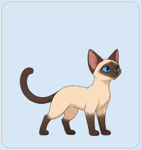
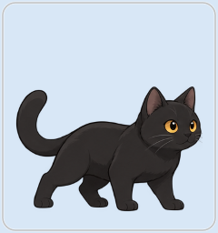
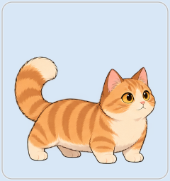
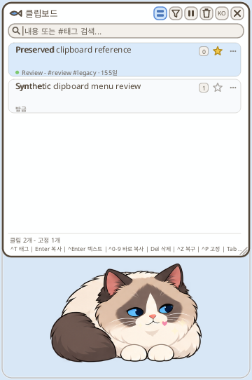

# ClipCat

**복사한 내용을 모으고, 곁에서 조용히 반응하는 데스크톱 고양이.**

ClipCat은 고양이 캐릭터와 클립보드 관리자를 하나로 묶은 데스크톱 앱입니다.
텍스트를 복사하면 고양이가 생선을 받아먹고, 내용은 로컬 히스토리에 저장됩니다.
필요할 때 검색하거나 태그로 찾아 다시 복사하고 붙여넣으세요.
고양이를 직접 클릭하면 종류마다 다른 짧은 몸짓으로 반응합니다.

[다운로드](https://github.com/buildon99x/copy-pet/releases/latest) ·
[개발 빌드](https://github.com/buildon99x/copy-pet/actions/workflows/ci.yml) ·
[변경 이력](CHANGELOG.md) · [English](#english)

> 이 README는 개발 브랜치 `main`을 기준으로 합니다. 공개 릴리스에는
> 아직 포함되지 않은 변경이 있을 수 있습니다. 차이는 [Unreleased](CHANGELOG.md#unreleased)를 확인하세요.

## 만나볼 고양이

| 랙돌 · Ragdoll | 샴 · Siamese | 봄베이 · Bombay | 먼치킨 · Munchkin |
| :---: | :---: | :---: | :---: |
|  |  |  |  |
| 푸른 눈과 풍성한 털 | 큰 귀와 날씬한 체형 | 검은 털과 구릿빛 눈 | 짧은 다리와 주황 줄무늬 |

위 이미지는 **최신 앱을 Linux에서 실제 실행해 캡처한 화면**입니다.
Linux는 배경 카드가 표시되며, Windows 네이티브와 macOS는 투명 배경을 사용합니다.
[촬영 정보](docs/images/README.md)를 함께 보관합니다.

처음부터 **12종을 자유롭게 선택**할 수 있습니다. 랙돌, 버만, 샴, 봄베이,
라가머핀, 페르시안, 터키시 앙고라, 아메리칸 컬, 먼치킨,
브리티시 쇼트헤어, 러시안 블루, 턱시도 무늬 고양이를 제공합니다.
턱시도는 품종이 아닌 털 무늬입니다.

메뉴의 **고양이 선택**에서 미리 보고 **함께하기**를 누르세요.
macOS·Linux에서는 고양이 창에 포커스를 준 뒤 `A`로도 열 수 있습니다.
외형뿐 아니라 복사 반응·쓰다듬기·표정·수면 자세가 다르며,
종류를 바꾸어도 클립보드 기록과 태그는 유지됩니다.
[고양이별 특징](docs/specs/cat-companions.md)

## 시작하기

### Windows

[Releases](https://github.com/buildon99x/copy-pet/releases/latest)에서
`clipcat-windows-x86_64.exe`를 받아 실행합니다. 별도 설치 과정은 없습니다.
트레이 아이콘에서 설정과 종료 메뉴를 사용할 수 있습니다.

### macOS

최신 개발 버전을 직접 테스트하려면
[CI 실행 목록](https://github.com/buildon99x/copy-pet/actions/workflows/ci.yml)에서
사용할 브랜치의 **macOS 빌드가 성공한 실행**을 선택하세요.

1. **Artifacts → `clipcat-macos-universal-test`**를 다운로드합니다.
2. 내려받은 ZIP과 그 안의 `ClipCat-macos-universal-test.zip`을 차례로 풉니다.
3. 실행 중인 ClipCat을 종료한 뒤 `ClipCat.app`을 엽니다.

Apple Silicon·Intel을 모두 지원하는 macOS 11 이상용 테스트 앱입니다.
GitHub 로그인이 필요할 수 있으며 아티팩트 보관 기간은 30일입니다.
빌드가 생략된 실행에는 패키지가 없으므로 macOS 빌드가 포함된 이전 성공 실행을 선택하세요.
패키지의 `build-info.json`에서 소스 커밋을 확인할 수 있습니다.

테스트 앱은 ad-hoc 서명이며 Apple 공증을 받지 않았습니다.
첫 실행이 차단되면 시스템 설정 → 개인정보 보호 및 보안에서 해당 앱의 열기를 허용하세요.
기존 ClipCat과 같은 로컬 기록·설정을 사용합니다.

### 첫 사용

1. 다른 앱에서 텍스트를 복사합니다. 고양이가 반응하고 기록이 저장됩니다.
2. 아래 OS별 단축키 또는 고양이 **가운데 클릭(휠클릭)**으로 클립보드를 엽니다.
3. 검색어를 입력하고 원하는 항목을 선택합니다.

| OS | 기본 전역 단축키 | 열리는 위치 |
| --- | --- | --- |
| Windows 네이티브 | `Win+Shift+V` | 입력 커서 부근의 별도 창. 등록 충돌 시 `Ctrl+Shift+V`로 대체 |
| macOS | **`Control+Shift+V`** | 입력 커서 부근의 별도 창. 위치를 얻지 못하면 마우스 커서 부근 |
| Linux X11 | `Super+Shift+V` | 고양이 창의 내장 패널 |

macOS 기본 단축키는 **Command가 아닌 Control**입니다.
메뉴에서 준비된 단축키 조합을 순환해 변경할 수 있습니다.
Linux Wayland에서는 전역 단축키를 등록하지 못할 수 있으며,
가운데 클릭이나 고양이 창에 포커스를 준 뒤 `C`를 사용하세요.

**선택 동작은 여는 방법에 따라 다릅니다.** Windows 네이티브·macOS의 전역
단축키 창에서는 항목 선택 시 원래 앱으로 붙여넣습니다.
가운데 클릭으로 연 내장 패널은 기본적으로 클립보드에 **다시 복사**합니다.
내장 패널에서도 바로 붙여넣으려면 **선택 시 붙여넣기**를 켜세요.
자동 붙여넣기는 대상 앱과 OS 권한에 따라 제한될 수 있습니다.

## 클립보드 사용법



*Linux 실제 실행 화면. 위 목록은 설명용 합성 데이터입니다.*

- **기록과 고정** — 최근 일반 항목 100개와 고정 항목 최대 100개를 로컬에 보관합니다.
  별표로 고정하고, 필요 없는 항목은 삭제하거나 삭제를 취소할 수 있습니다.
- **텍스트와 앱 검색** — 내용·출처 앱·태그를 검색합니다. 깔때기 버튼으로
  출처 앱 필터를 함께 적용할 수 있습니다.
- **태그** — 항목의 `… → #` 또는 `Ctrl/Cmd+T`로 편집합니다.
  공백이나 쉼표로 구분해 입력하고 `Enter`로 저장합니다. 항목당 최대 8개, 태그당 최대 24자입니다.
- **서식 유지와 일반 텍스트** — Windows·macOS에서는 HTML/RTF 서식을 보존합니다.
  서식을 빼려면 항목의 텍스트 붙여넣기 동작 또는 `Ctrl/Cmd+Enter`를 사용하세요.
- **이미지 기록** — **Windows 네이티브 전용**입니다. 복사한 PNG·지원 DIB 이미지를
  썸네일로 보고 다시 복사·붙여넣기합니다. 이미지에도 고정·태그를 적용할 수 있습니다.
  파일 탐색기의 파일 복사나 OCR은 지원하지 않습니다.
- **보기와 크기** — 카드/목록 보기를 전환하고 패널 헤더를 드래그해 이동하거나
  오른쪽 아래 모서리로 크기를 조절합니다. 설정은 다음 실행에도 유지됩니다.
- **수집 일시정지** — 패널의 일시정지 버튼이나 설정 메뉴에서 수집을 멈춥니다.

| 검색 예시 | 결과 |
| --- | --- |
| `보고서` | 내용·앱 이름·태그에 해당 단어가 포함된 항목 |
| `#업무` | `업무` 태그가 정확히 일치하는 항목 |
| `#업무 #참고` | 두 태그를 모두 가진 항목 |
| `#업무 보고서` | `업무` 태그와 검색어 `보고서`가 모두 일치하는 항목 |

영문 대소문자는 구분하지 않습니다. 일반 검색은 태그 일부에도 일치하지만,
`#tag`는 태그 전체가 일치해야 합니다.
[태그·이미지 지원 형식과 저장 한도](docs/specs/clipboard-tags-images.md)

### 자주 쓰는 조작

아래 `Ctrl/Cmd`는 Windows·Linux에서는 Ctrl, macOS에서는 Command입니다.
전역 패널 단축키의 macOS **Control**과 구분하세요.

| 조작 | 동작 |
| --- | --- |
| 고양이 몸을 누르고 드래그 없이 놓기 | 종류별 짧은 교감 모션과 기상 |
| 고양이 드래그 | 위치 이동. 위치 잠금 중에는 이동하지 않음 |
| 가운데 클릭 | 내장 클립보드 패널 열기/닫기 |
| 패널에서 타이핑 / 방향키 / `Enter` | 검색 / 항목 이동 / 선택 |
| `Esc` | 검색어·필터를 해제한 뒤 패널 닫기 |
| `Ctrl/Cmd+T` | 선택한 항목의 태그 편집 |
| `Ctrl/Cmd+P` | 고정/해제 |
| `Ctrl/Cmd+0`–`9` | 숫자 배지가 붙은 행 바로 선택 |
| `Ctrl/Cmd+Enter` | 선택한 텍스트를 서식 없이 붙여넣기 |
| `Delete` / `Ctrl/Cmd+Z` | 선택 항목 삭제 / 삭제 취소 |
| `Tab` | 출처 앱 필터 순환 |

Windows는 트레이 메뉴, macOS는 고양이 우클릭 메뉴에서 설정합니다.
크기·위치 잠금·항상 위/일반/숨김 창 모드·자동 실행·자동 업데이트 등을 바꿀 수 있습니다.
macOS·Linux에서 **패널이 닫히고 고양이 창에 포커스가 있을 때**는
`C` 패널 · `A` 고양이 선택 · `S` 크기 · `L` 위치 잠금 · `G` 언어 ·
`K` 전역 단축키 변경 · `V` 카드/목록 · `O` 복사 후 닫기 · `Q` 종료를 사용할 수 있습니다.

## 조용한 동료와 개인정보

복사하거나 고양이를 직접 쓰다듬을 때 반응합니다. 다른 앱에서 타이핑하거나
마우스를 클릭·스크롤하거나 고양이 위에 커서를 올리는 것으로는 반응하거나 깨지 않습니다.
복사나 직접 교감 없이 약 75초가 지나면 잠들며, 잠든 동안에도 클립 수집은 계속됩니다.
위치 잠금·수집 일시정지 중에도 직접 쓰다듬을 수 있습니다.
정지된 대기·수면 프레임은 다시 그리지 않으며 상세 이미지 캐시는 선택한 한 마리만 유지합니다.

- 전역 키·마우스 입력 감시와 입력 횟수 통계를 사용하지 않습니다. XP·레벨·액세서리도 없습니다.
- 전역 단축키는 OS에 조합을 등록하는 방식이며 **입력 모니터링 권한을 요청하지 않습니다**.
  macOS에서 커서 위치 조회나 자동 붙여넣기는 접근성 권한에 따라 제한될 수 있습니다.
- 기록과 태그·설정은 로컬 JSON 파일에 저장합니다. 저장 파일 자체는 암호화하지 않습니다.
  민감한 내용을 기록하고 싶지 않을 때는 수집 일시정지를 사용하세요.
- 앱의 네트워크 기능은 **GitHub 릴리스 업데이트 확인·다운로드**뿐입니다.
  자동 확인은 기본으로 켜져 있으며 설정에서 끌 수 있습니다. 클립 내용은 전송하지 않습니다.
  macOS의 업데이트 메뉴는 universal 앱을 내려받아 설치하고 다시 시작합니다.
  이 수정 이전 버전은 첫 업데이트를 수동으로 설치해야 합니다. macOS가 요청하면
  손쉬운 사용 권한을 다시 허용하세요.
- AI 작업대 메뉴·하단 링크·`Ctrl/Cmd+B`는 제거했습니다.
  기존 `requests.json` 프로젝트 파일은 보존합니다.

| OS | 데이터 폴더 |
| --- | --- |
| Windows | `%APPDATA%\ClipCat` |
| macOS | `~/Library/Application Support/ClipCat` |
| Linux | `$XDG_CONFIG_HOME/ClipCat` 또는 `~/.config/ClipCat` |

`clips.json`은 기록·태그·이미지, `state.json`은 설정입니다.
텍스트 항목은 256 KiB까지 저장하며 고정되지 않은 오래된 항목은 개수 한도에 따라 정리됩니다.

## OS별 지원 범위

| 기능 | Windows 네이티브 | macOS | Linux |
| --- | --- | --- | --- |
| 고양이 12종·교감·태그·검색 | 지원 | 지원 | 지원 |
| 배경 | 투명, 투명 영역 클릭 통과 | 투명 | 불투명 카드 |
| 텍스트 기록 | 지원 | 지원 | 지원 |
| HTML/RTF 보존 | 지원 | 지원 | 일반 텍스트 |
| 이미지 기록·재복사 | 지원 | 미지원 | 미지원 |
| 단축키 창 | 별도 플라이아웃 | 별도 플라이아웃 | 내장 패널, X11 전역 단축키 |
| 설정 | 트레이 메뉴 | 우클릭 메뉴·로컬 단축키 | 로컬 단축키 |
| 이벤트 소리 | 지원, 끌 수 있음 | 무음 | 무음 |

Windows의 `--features portable` 빌드는 macOS·Linux와 같은 portable 백엔드를 사용하므로
Windows 네이티브 이미지 기록 기능을 제공하지 않습니다.
macOS는 Retina 배율에 맞춰 논리 크기와 시스템 글꼴을 렌더링합니다.
UI 언어는 한국어·영어를 전환할 수 있습니다.

## 브랜치와 출시

`main`은 최신 개발 코드이고, `production`은 최종 공개 정식 릴리스와 같은 커밋입니다.
main의 검증된 버전을 production으로 승격하면 출시됩니다.
출시 후보의 버전 태그만으로는 출시 완료가 아니며 CI 공개·승격 성공을 확인합니다.
[출시·실패 복구 절차](docs/releasing.md)를 참고하세요. Microsoft Store 제출·심사는 별도로 진행합니다.

## 소스에서 빌드

Rust stable이 필요하며 Windows는 MSVC 도구 체인을 사용합니다.
Linux는 아래 시스템 라이브러리를 먼저 설치하세요.

```bash
# Debian / Ubuntu
sudo apt-get install libx11-dev libxi-dev libxtst-dev libxkbcommon-dev libxkbcommon-x11-dev pkg-config
```

```bash
git clone --branch main https://github.com/buildon99x/copy-pet.git
cd copy-pet
cargo build --locked --release
cargo run --locked --release --bin clipcat
```

실행 파일은 `target/release/clipcat` 또는 `target/release/clipcat.exe`입니다.
Windows에서 portable 백엔드를 확인하려면 `cargo build --locked --release --features portable`을 사용합니다.

```bash
cargo test --locked --release
cargo clippy --locked --release
bash scripts/release.sh verify
```

Rust 공통 코어와 Win32 / winit·softbuffer 백엔드를 사용합니다.
캐릭터 아틀라스는 바이너리에 포함하며 UI 글꼴은 OS에서 읽습니다.

- [제품 동작 명세](docs/specs/clipcat-spec.md)
- [캐릭터와 모션](docs/specs/cat-companions.md)
- [원화·생성 프롬프트 보관소](art/README.md)
- [설계 결정](.context/kb/adr/README.md) · [기여 작업 가이드](AGENTS.md)

## English

**A quiet desktop cat that keeps your clipboard close.** Copy text to feed your
cat and save it locally. Search history, pin useful clips, add tags and copy them
back. Pick from twelve companions, with distinct illustrations, copy reactions,
affection gestures and sleeping poses. The four images above are unmodified
screenshots of the current Linux app, not concept art.

This README describes the current development source. Published releases may
lag behind it; see [Unreleased](CHANGELOG.md#unreleased).

- **Get it:** [Releases](https://github.com/buildon99x/copy-pet/releases/latest)
  for published binaries. Universal macOS test apps are available from successful
  macOS runs in [CI](https://github.com/buildon99x/copy-pet/actions/workflows/ci.yml):
  download `clipcat-macos-universal-test`, unpack both ZIP layers, quit an existing
  copy and open `ClipCat.app`. Supports Apple Silicon and Intel, macOS 11+.
  Artifacts expire after 30 days and may require GitHub sign-in. Test apps are
  ad-hoc signed, not notarized; if blocked, allow this app in Privacy & Security.
- **Open history:** `Win+Shift+V` on Windows, **`Control+Shift+V` on macOS**, or
  `Super+Shift+V` on Linux X11. Middle-click opens the embedded panel. On portable,
  focus the cat and press `C`; `A` opens the cat gallery.
- **Copy vs paste:** selecting a clip in the Windows native/macOS hotkey flyout
  pastes into the previous app. The embedded panel copies by default; enable
  **Paste on select** for automatic paste there. Target apps and OS permissions
  can limit paste simulation.
- **Tags:** use `… → #` or `Ctrl/Cmd+T`, then Enter to save. Search `#work` for
  an exact tag, `#work #reference` for both, or `#work report` for tag plus text.
  Plain words also match partial tags; searches ignore case.
- **Formats:** Windows native/macOS preserve HTML/RTF; Linux uses plain text.
  `Ctrl/Cmd+Enter` pastes text without formatting. Image capture and copy-back
  are **Windows native only**. See [format limits](docs/specs/clipboard-tags-images.md).
- **Quiet by design:** click and release on the cat without dragging for a brief
  response. Typing, unrelated mouse activity and hovering stay quiet. No activity
  counters, XP, levels or global input listeners. Hotkeys use OS registration;
  macOS does not request Input Monitoring. Accessibility permissions can affect
  caret positioning and automatic paste.
- **Local data:** JSON settings/history remain on your machine, unencrypted.
  Pause capture whenever needed. The only in-app network feature is GitHub
  release checking/downloading; automatic checks can be disabled. No clip content
  is uploaded. AI workbench entry points were removed; existing drafts are retained.
- **Build:** `cargo build --locked --release`; Linux needs the X11 development
  packages listed above. Tests: `cargo test --locked --release`.

Tuxedo is a coat pattern rather than a breed. Character personalities describe
these fictional companions, not every real cat of a breed.
